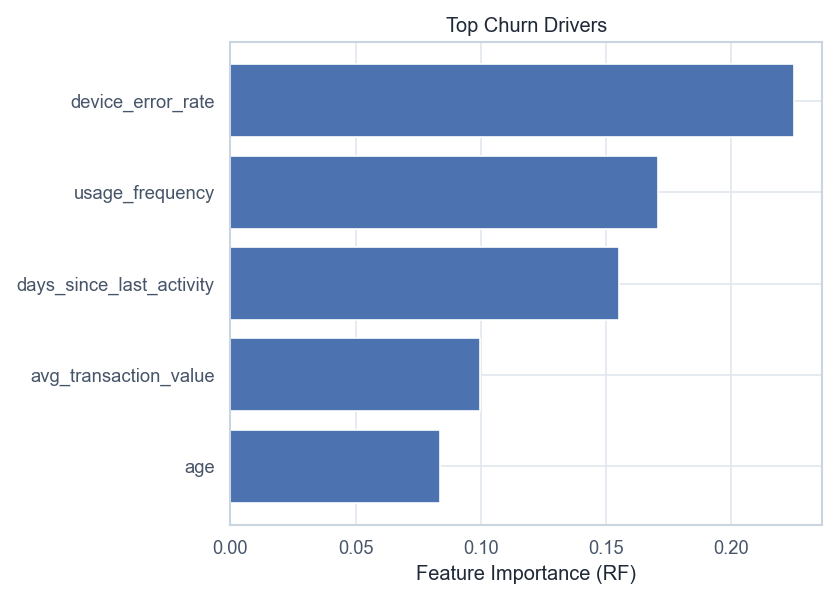
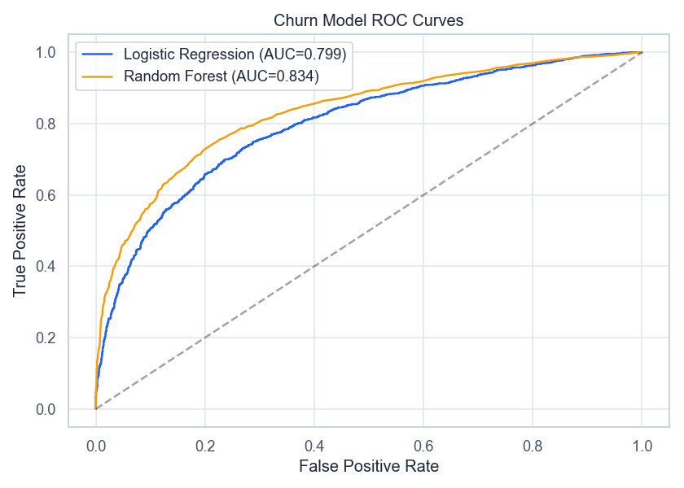
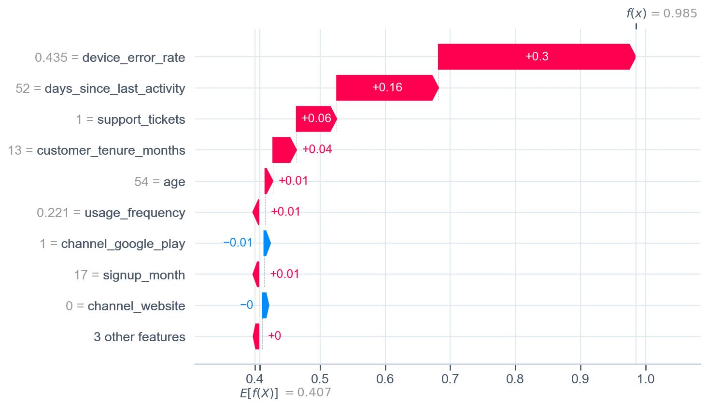

# Volta — Churn Prediction

[](https://github.com/NikitaBoyarkin/case-churn/actions/workflows/ci.yml)

[](LICENSE)

Random Forest adds +0.03 ROC-AUC over logistic regression; the top churn driver is device-error rate (23.7%), not balance or activity.

## Key results

- RF +0.03 ROC-AUC over LR
- Top driver — device_error_rate (23.7%)
- SHAP for local prediction interpretation

## Situation

Churn is not only a marketing problem: we need to know what actually drives leaving in order to pick a lever.

## Task

My job was to find out what actually drives customers to leave, since churn is not only a marketing problem and the right lever has to be picked first.

## Actions

- Logistic regression vs Random Forest, ROC-AUC and feature importance.
- SHAP summary (mean |SHAP|) and local breakdown of a single prediction.

### Local SHAP


*Why one specific user is high risk: each feature's contribution.*

## Result

- Random Forest adds **+0.03 ROC-AUC** over LR — a modest but robust gain.
- Top driver is **device-error rate (23.7%)**, then usage_frequency (18.7%) and days_since_last_activity (16.5%).
- Balance and activity rank below product reliability.

## Recommendations

- Route churn prevention into product reliability and support, not just offers.
- Use SHAP for targeted risk scoring.
- Monitor device-error rate as a retention guardrail metric.

## Charts








## Dataset

The dataset is fully synthetic, generated by seeded, reproducible script(s) (`scripts/generate_churn_data.py`). No real customer data is used. Running `make data` regenerates the CSV(s) in `data/` with the same random seed, so every number below is reproducible.

## Quick start

```bash
uv sync --all-groups
make data
make run
```

## Project structure

```text
case-churn/
├── README.md
├── LICENSE
├── .gitignore
├── .python-version
├── pyproject.toml
├── Makefile
├── .github/workflows/ci.yml
├── scripts/
│   ├── generate_churn_data.py
│   └── volta_churn_prediction.py
├── utils/
│   ├── __init__.py
│   ├── common.py
│   └── viz_helpers.py
├── data/
│   └── volta_churn_data.csv
├── outputs/
│   ├── churn_feature_importance.png
│   ├── churn_roc_curve.png
│   ├── churn_shap_local.png
│   ├── churn_shap_summary.png
└── tests/
    └── test_churn.py
```

## Stack

- Python
- pandas / NumPy
- SciPy / Statsmodels
- scikit-learn
- Matplotlib / Seaborn
- uv + ruff

## Links

- [Full case study on the portfolio site](https://nikitaboyarkin.github.io/en/projects/volta/churn/)
- [Parent project — volta-banking](https://github.com/NikitaBoyarkin/volta-banking)
